# Alert App

Users set up alerts on news (by keywords or by category) and get notified by **email** or **Slack** when matching
articles appear. Admins manage the users.

> **The PM's brief:** "We want users to be able to set up alerts so they get notified when something important
> happens in the world — like breaking news, market movements, natural disasters, that kind of thing. Should work
> for both email and Slack. Make it flexible enough that we can add more channels later. We need an admin view too."

The PM wasn't available for questions, so we made the product decisions ourselves and wrote them down, with the
reasons, in [docs/PROJECT_PLAN.md](docs/PROJECT_PLAN.md). The open ones are listed under
[Questions for the product team](#questions-for-the-product-team) below.

**Contents:** [Notes for the reviewer](#notes-for-the-reviewer) ·
[What's done](#whats-done) · [Screenshots](#screenshots) · [How it works](#how-it-works) ·
[Built to be extended](#built-to-be-extended) · [What's not done yet](#whats-not-done-yet) ·
[Questions for the product team](#questions-for-the-product-team) · [Tech stack](#tech-stack) ·
[Running it locally](#running-it-locally) · [Repository](#repository)

---

## Notes for the reviewer

### The developer's summary

This application was built with the help of Claude Code. My first step was to decide how to approach the task:
I set up the application first, then defined the milestones based on the brief. When it became clear that there
would not be enough time to cover everything, I chose the milestones that mattered most and moved everything else
to the [TODO list](#whats-not-done-yet).

I aimed to build an extensible application: what is here is the core, and further channels, alert rule types,
data sources and similar features can be added easily later (see [Built to be extended](#built-to-be-extended)).

As a frontend developer, I focused mainly on the frontend code. Nevertheless, I made an effort to understand the
backend as well, concentrating on the overall flow and how it is set up. I read through the backend code, but my
own contribution to it was limited, and I largely relied on Claude there.

I saved my conversations with Claude for every milestone in
[docs/claude-conversations/](docs/claude-conversations/): the full, unedited export, and a readable version that
Claude prepared from it. From milestone 2 on, I used a separate branch for each milestone, so the state of the
application and the way it evolved can be followed more easily.

The application is basic, but it works without issues. The setup steps are described in
[Running it locally](#running-it-locally).

### Technical summary

- **The full flow works end to end with real services:** news is fetched from NewsData.io, matched against
  every user's alerts, and delivered as an email (Resend) and a Slack message (incoming webhook). The
  [screenshots](#screenshots) show real alerts, because the app can't be run without our API keys (see
  [Running it locally](#running-it-locally)).
- **Scope:** alerts, email, real news and Slack are done. Digests, the bigger admin view and production setup are
  in the [TODO list](#whats-not-done-yet). The brief's "admin view" is covered only by user management so far.
- **Only news is a data source today.** Market movements and natural disasters are reached through news categories
  (`business`, `environment`). A dedicated source is one new class, see
  [Built to be extended](#built-to-be-extended).
- **Quality:** 327 automated tests (unit tests in all three packages, and end-to-end API tests against a real
  Postgres and Redis). TypeScript, ESLint and Prettier are clean. A final code review found 9 edge cases: 5 are
  fixed with tests, 4 are written down in the TODO list
  ([details](docs/PROJECT_PLAN.md#wrap-up-code-review-fixes)).
- **Known limits of the free tiers:** NewsData.io delays articles by up to ~12 hours (no real "breaking news"),
  and Resend sends only to the account owner until a domain is verified. Both are questions for the product team.
- **Where to start reading the code:** the alert pipeline (fetch → match → notify) in
  [alert-app-backend/src/](alert-app-backend/src/) (`news-sources/`, `matching/`, `notifications/`), and the two
  extension points, [news-source-adapter.ts](alert-app-backend/src/news-sources/news-source-adapter.ts) and
  [notification-channel.ts](alert-app-backend/src/channels/notification-channel.ts).
- **How it was built:** in vertical slices, one feature at a time through every layer (model → API contract →
  UI → backend → connect → tests). Every decision and its reason is in
  [docs/PROJECT_PLAN.md](docs/PROJECT_PLAN.md).

---

## What's done

| #   | Milestone           | What it gives                                                                                                   |
| --- | ------------------- | --------------------------------------------------------------------------------------------------------------- |
| 0   | Setup               | Monorepo (frontend, backend, shared package), Docker for Postgres and Redis, linting, formatting, tests         |
| 0.5 | Frontend foundation | Page layout, error and 404 pages, loading states, notifications, theme, translations (i18next)                  |
| 1   | Login               | Sign up, log in, log out, protected pages, user roles (Better Auth, sessions in httpOnly cookies)               |
| 2   | Admin: users        | Admins list and search users, change their role, disable or enable accounts                                     |
| 3   | Alert rules         | Create, edit, delete and turn alerts on or off. An alert matches **keywords** (all of them) or **one category** |
| 4   | Email channel       | Every user has an email channel (their account email), with a "Send test message" button (Resend)               |
| 5   | First real alerts   | News is fetched every 2 hours, matched against every alert, and sent instantly with retries (BullMQ jobs)       |
| 7   | Slack               | Connect a Slack channel with an incoming webhook, edit it, send a test message, choose it per alert             |

**Every page works on phones, tablets and desktops**, and has basic accessibility (labels, keyboard use, visible
focus, screen-reader texts). All texts go through translations, so adding a language is one folder.

**Alerts are matched like this:** all keywords must be in the title or description (whole words, case and accents
ignored, phrases in order). Category alerts use our own category list (world, politics, business, technology,
science, health, sports, environment, other). Each alert sends **one message per fetch** with all its new
articles, to every channel the user picked for it.

---

## Screenshots

The app was running locally with real API keys. The email and the Slack message are real alerts.

| Log in                                   | Sign up (with validation)                   |
| ---------------------------------------- | ------------------------------------------- |
| 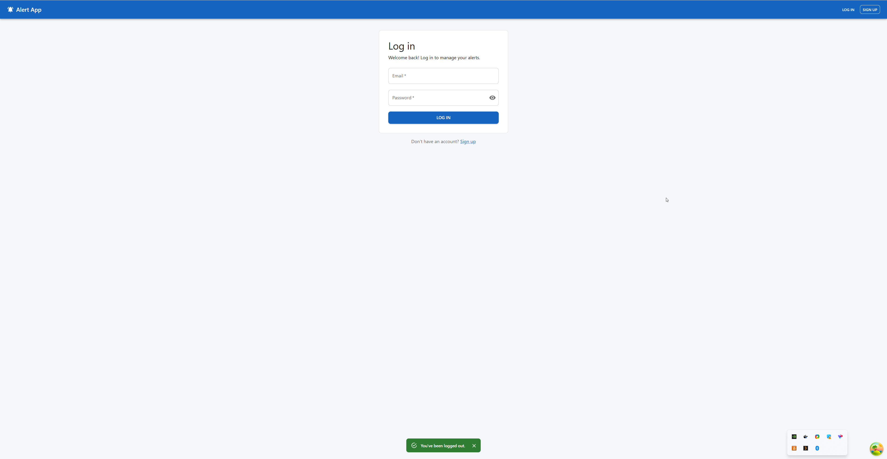 | 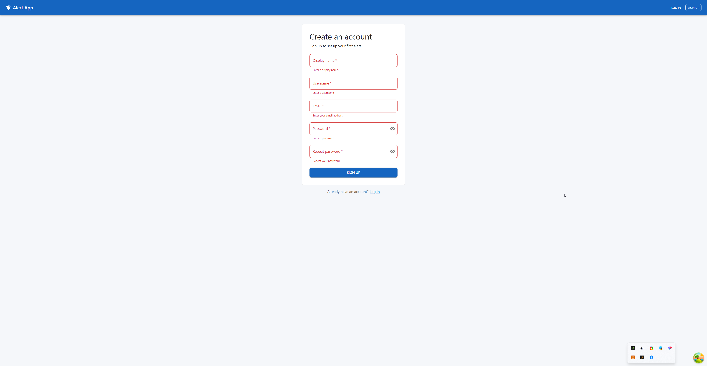 |

| My alerts (with "Sends to" and "Last alert")    | New alert dialog                                |
| ----------------------------------------------- | ----------------------------------------------- |
| 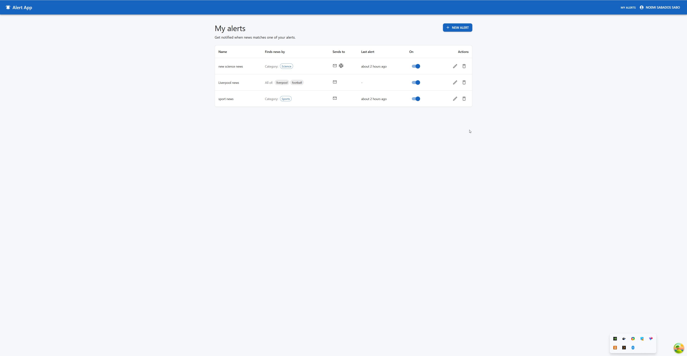 | 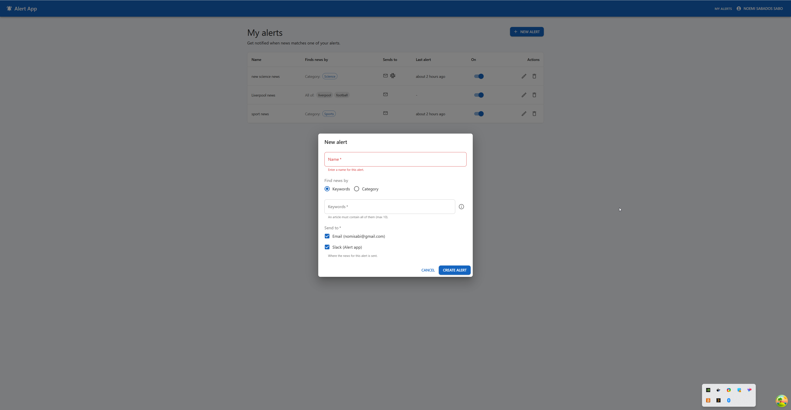 |

| Channels: email and Slack                     | Edit Slack (the webhook URL is never shown again) |
| --------------------------------------------- | ------------------------------------------------- |
| 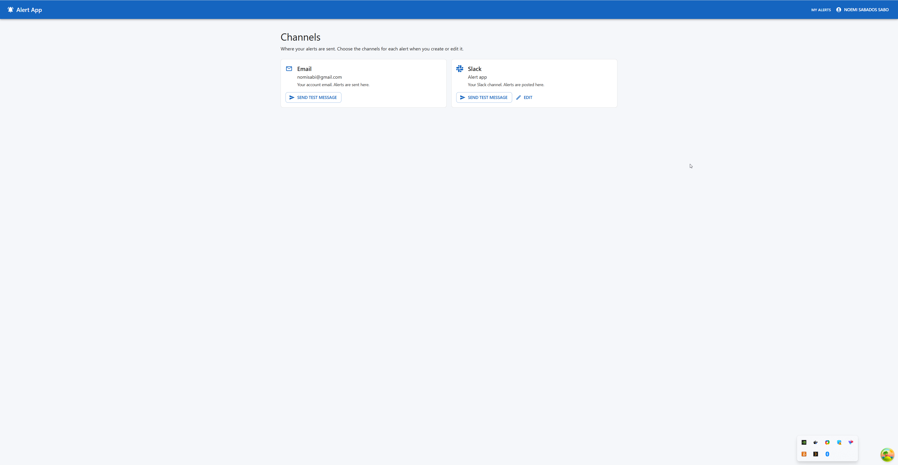 | 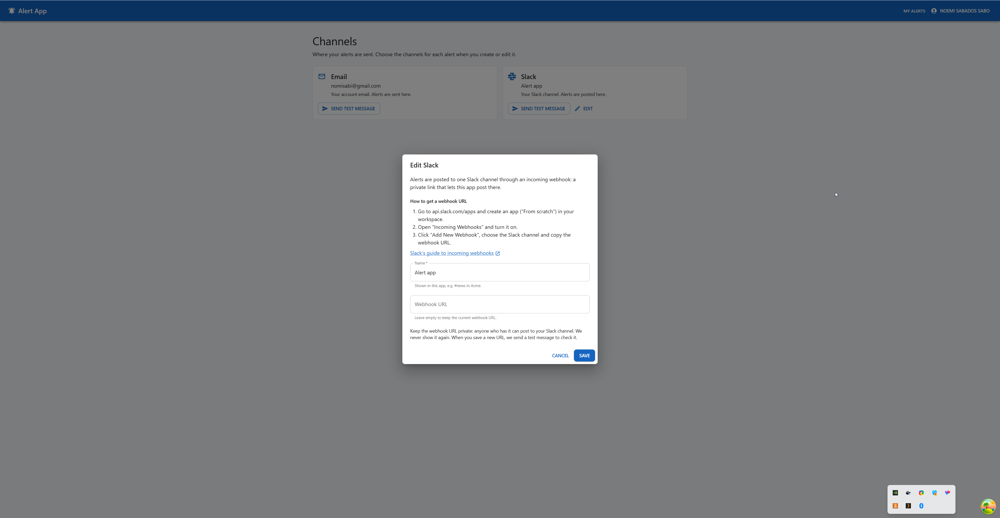 |

| A real alert by email                               | The same kind of alert in Slack                         |
| --------------------------------------------------- | ------------------------------------------------------- |
| 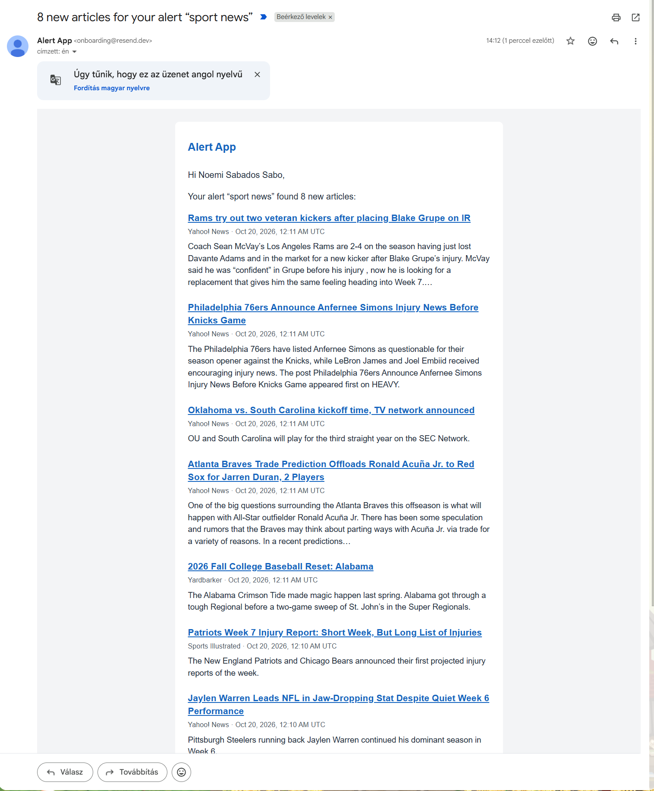 | 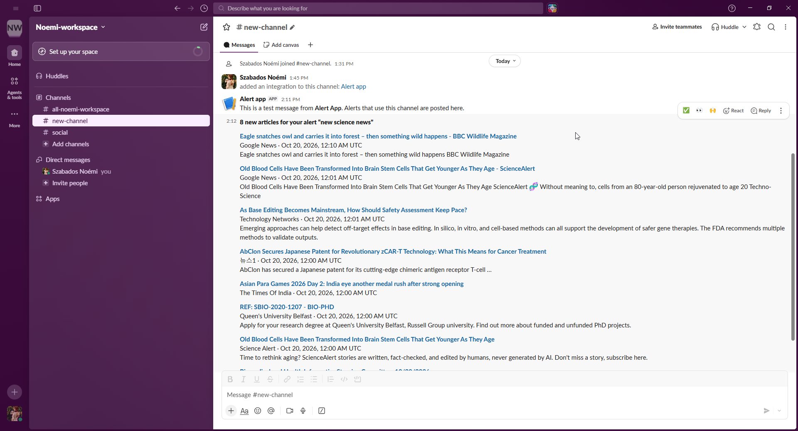 |

| Admin: users                                        | API documentation (Swagger, `/api/docs`)    |
| --------------------------------------------------- | ------------------------------------------- |
| 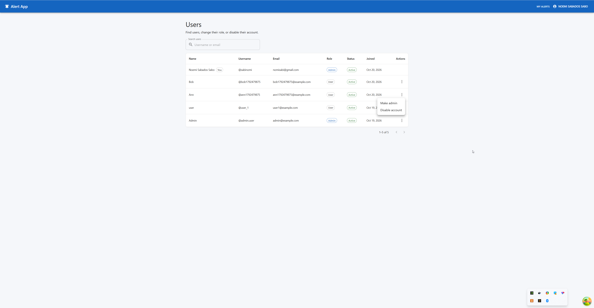 | 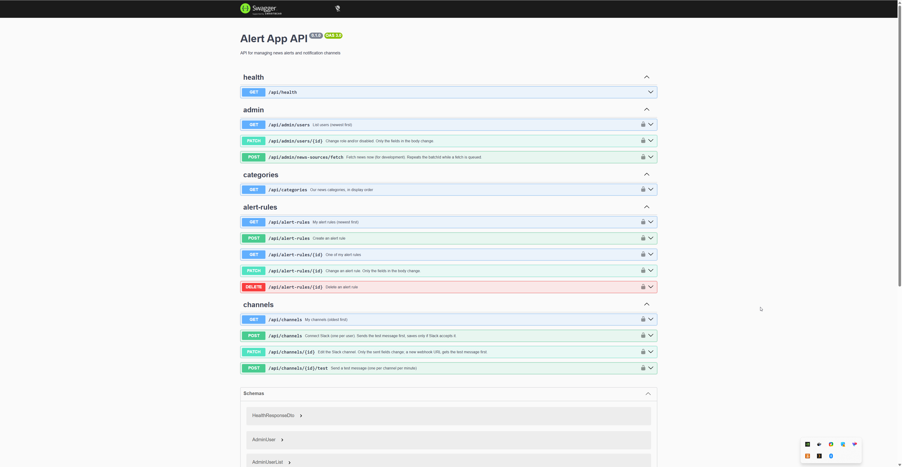 |

| Database (Prisma Studio)                      | Page not found                                  |
| --------------------------------------------- | ----------------------------------------------- |
| 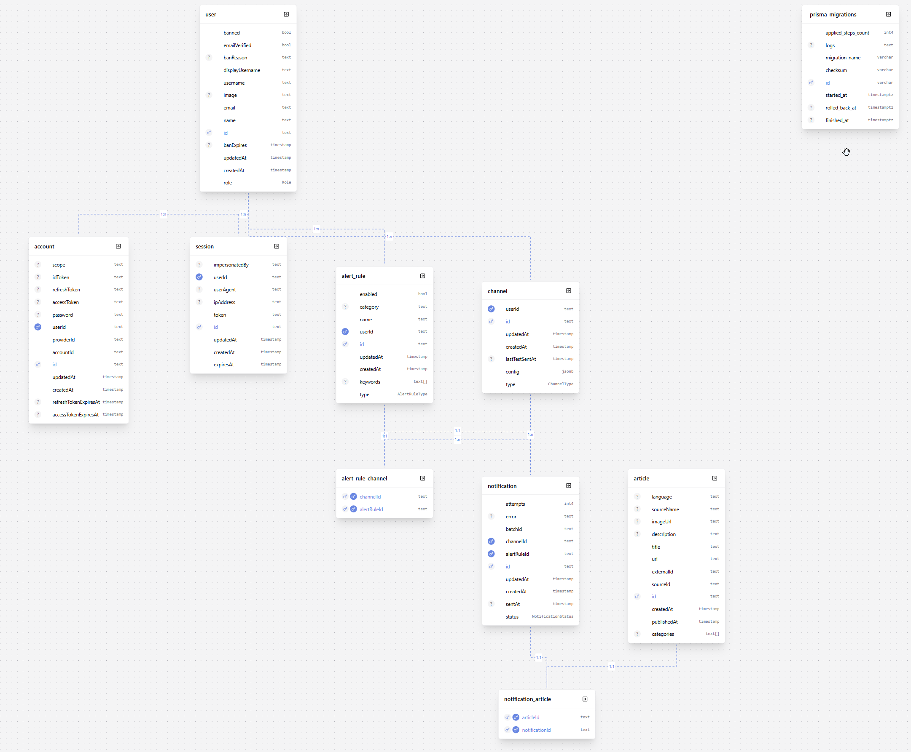 | 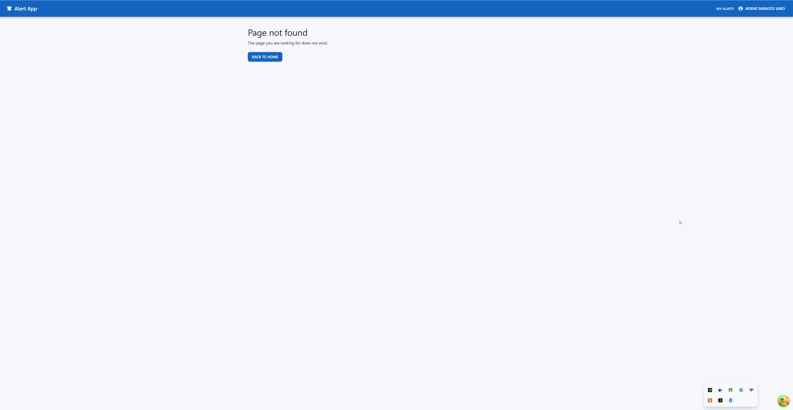 |

---

## How it works

```
 every 2 hours (BullMQ repeatable job)              or an admin: POST /api/admin/news-sources/fetch
        │
        ▼
 1. Ingest   news-sources/   each NewsSourceAdapter fetches the latest articles → our own NormalizedArticle
                             → saved once (unique URL)
        │
        ▼
 2. Match    matching/       every enabled alert of every active user against the new articles
                             → one pending Notification per alert + channel (with all its articles)
        │
        ▼
 3. Notify   notifications/  a queue job per notification → ChannelsService → EmailChannel / SlackChannel
                             → sent or failed (3 attempts, never sent twice, max 2 sends per second)
```

- **Background jobs** run in BullMQ queues on Redis, so a slow or failing provider never blocks the API, and failed
  sends are retried (30s, then 60s). Errors that retrying can't fix (a removed Slack webhook, an invalid email) fail
  at once.
- **One Zod schema per shape** (in `packages/shared`) validates the frontend forms and the backend requests and
  generates the OpenAPI docs. The frontend's API hooks are generated from those docs (Orval), so both sides always
  agree.
- **Security basics:** every query filters by the logged-in user (another user's data looks "not found"),
  admin endpoints check the role, the Slack webhook URL is a secret (never returned, never logged, only
  `hooks.slack.com` URLs accepted), and test messages are limited to one per minute.

---

## Built to be extended

The brief asks for "flexible enough that we can add more channels later". The same idea is used for every part
that is likely to grow: the code depends on a small interface, and each provider is one class behind it.

### News sources: only news today, any source is one class

**We only added news (NewsData.io).** The brief also mentions market movements and natural disasters. Those are a
new `NewsSourceAdapter` each, for example Finnhub or Alpha Vantage for markets, and USGS or GDACS for
earthquakes and disasters. The matcher, the queues, the channels and the UI don't change.

```ts
// alert-app-backend/src/news-sources/news-source-adapter.ts
export interface NewsSourceAdapter {
  readonly sourceId: string;
  fetchLatest(): Promise<NormalizedArticle[]>; // the provider's data in our own shape
}
```

Adding a source:

1. A class that implements `NewsSourceAdapter` and maps the provider's data (and categories) to ours, like
   [newsdata.adapter.ts](alert-app-backend/src/news-sources/newsdata/newsdata.adapter.ts).
2. One line in the `NEWS_SOURCES` list in
   [news-sources.module.ts](alert-app-backend/src/news-sources/news-sources.module.ts) (with its API key from
   the environment).
3. If it brings a new kind of topic, one new value in our category list (`AppCategory` in `packages/shared`). The
   frontend loads the categories from the API, so it needs no change.

### Notification channels

Slack was added this way in milestone 7, without changing the alert pipeline. Teams, SMS or generic webhooks
would be one class each.

```ts
// alert-app-backend/src/channels/notification-channel.ts
export interface NotificationChannel {
  readonly type: ChannelType;
  validateConfig(config: unknown): void;
  destination(target: ChannelTarget): string; // what the Channels page shows
  send(target: ChannelTarget, message: ChannelMessage, language: Language): Promise<void>;
}
```

Messages are channel-independent (`{ kind: 'test' }` or `{ kind: 'alert', ruleName, articles, ... }`): each
channel turns them into its own format (an HTML email, Slack blocks). Adding a channel = the class, one line in
`NOTIFICATION_CHANNELS` ([channels.module.ts](alert-app-backend/src/channels/channels.module.ts)), a new
`ChannelType` value and its settings form.

### Email provider

Email goes through an `EmailProvider` class (Resend today). Switching to SendGrid, Mailgun or Amazon SES is one
small class. Without an API key, emails are written to the log instead.

---

## What's not done yet

The full list, with details, is the [TODO list in the project plan](docs/PROJECT_PLAN.md#todo-later).

**Next steps**

- **Bull Board:** a ready-made admin page for the background queues (waiting, failed, retry). About 1–2 hours.
- **Admin view (milestone 8):** all users' alerts (turn any on or off), news source status and settings, a
  notification log with a retry button.
- **Digests (milestone 6):** hourly or daily summaries instead of instant alerts, with a time zone setting.
- **Email verification and password reset (milestone 9).**
- **Production readiness (milestone 10):** rate limiting, monitoring, hosting and deployment, a verified email
  domain, encrypted Slack webhook URLs.

**More data sources:** market movements and natural disasters (see
[Built to be extended](#built-to-be-extended)).

**Smaller items:** "any keyword" matching and keywords + category together, a "Recent alerts" page, a settings
page (language, time zone), "Add to Slack" with one click (OAuth), deleting channels, React Email templates,
admin user filters, Google login / 2FA, Playwright browser tests.

**From the final code review:** 4 edge cases are written down with their fixes (two Slack channels created at the
same moment, no limit on rejected Slack URLs until rate limiting exists, old stored settings after a stricter
validation rule, Slack formatting characters in article titles).

---

## Questions for the product team

Collected while building the app. Each one has the default we use until there's an answer. The same list, with
the notes behind each question, is at the end of [docs/PROJECT_PLAN.md](docs/PROJECT_PLAN.md#questions-for-the-manager).

**News data**

1. **Is NewsData.io's free tier good enough?** Articles arrive up to ~12 hours late (no real "breaking news"),
   and the ~200 requests a day only allow fetching our 9 categories every 2 hours. The first real fetch showed
   that the newest 10 articles per category cover only ~20 minutes of news, so **most articles are never seen**
   and alerts can miss news. Should we pay for a plan, or add more sources?
   _Default: free tier, fetched every 2 hours._
2. **Are English articles enough?** Other languages would need a language choice per user or per alert.
   _Default: English only._
3. **Which other alert types matter most** (market movements, natural disasters)?
   _Default: news with categories only._

**Notifications**

4. **Is Resend's free tier enough?** 100 emails a day and 3,000 a month **for all users together**, and it needs
   a verified domain to send to anyone else than the account owner. Do we have a company domain, and is a paid
   plan possible? _Default: free tier, with a verified domain if there is one._
5. **Is pasting a Slack webhook URL OK for users**, or do they expect a one-click "Add to Slack" button (more
   work)? _Default: the user creates a webhook in Slack and pastes its URL._

**Alert rules**

6. **Should keyword alerts match all keywords or any of them?** Or should users choose? Should a keyword also
   match other forms (`car` → "cars")? _Default: all keywords, exact whole words._
7. **Should one alert combine keywords and a category** (or several categories)?
   _Default: keywords or one category._
8. **Are hourly or daily digests needed for the first release?** _Default: every alert is sent instantly._

**Users and admin**

9. **Is email and password enough to log in?** Or are Google login, SSO or 2FA needed?
   _Default: email and password._
10. **Do admins need filters (role, status) and sorting in the user list?**
    _Default: search by username or email, and pages._


---

## Tech stack

| Part     | What we use                                                                                                 |
| -------- | ----------------------------------------------------------------------------------------------------------- |
| Frontend | React, Vite, MUI, TanStack Query, React Hook Form + Zod, i18next, date-fns, SASS modules, Orval (API hooks) |
| Backend  | NestJS, Prisma + PostgreSQL, BullMQ + Redis, Better Auth, Resend, Swagger (OpenAPI)                         |
| Shared   | `@alert-app/shared`: Zod schemas, types and constants used by both sides                                    |
| Tests    | Vitest, Testing Library (frontend), supertest end-to-end tests against a real database (backend)            |
| Tooling  | npm workspaces, TypeScript, ESLint, Prettier, Docker Compose                                                |

---

## Running it locally

**The app needs our own API keys to do anything useful,** and they can't be shared. That's why the screenshots
are here. With your own free keys, it runs like this:

- **NewsData.io** (`NEWSDATA_API_KEY`): without it, no news is fetched (a warning in the log).
- **Resend** (`RESEND_API_KEY`, `EMAIL_FROM`): without it, emails are written to the backend log.
- **Slack:** each user pastes their own incoming webhook URL in the app (no key in `.env`).

**Requirements:** Node.js 24.15+, Docker Desktop (for PostgreSQL and Redis).

```bash
# 1. Install all dependencies (always from the repo root)
npm install

# 2. Create your local env files, then fill in the keys in alert-app-backend/.env
cp .env.example .env
cp alert-app-backend/.env.example alert-app-backend/.env

# 3. Start PostgreSQL (port 5433) and Redis (port 6379)
npm run db:up

# 4. Create the tables and the first admin (from ADMIN_* in alert-app-backend/.env)
npm run db:migrate -w alert-app-backend
npm run db:seed -w alert-app-backend

# 5. Start the backend (http://localhost:3000/api, Swagger at /api/docs)
npm run dev:backend

# 6. Start the frontend (http://localhost:5174)
npm run dev:frontend
```

As an admin, `POST /api/admin/news-sources/fetch` in Swagger fetches news right away instead of waiting up to
2 hours (it costs 10 of the ~200 daily NewsData.io requests).

### Scripts (from the root)

| Script                                  | Description                                 |
| --------------------------------------- | ------------------------------------------- |
| `npm run dev:frontend`                  | Start the frontend dev server               |
| `npm run dev:backend`                   | Start the backend with auto-reload          |
| `npm run dev:shared`                    | Rebuild the shared package on save          |
| `npm run build`                         | Build all projects                          |
| `npm run lint`                          | Lint all projects                           |
| `npm run test`                          | Unit tests in all projects                  |
| `npm run test:e2e -w alert-app-backend` | Backend end-to-end tests (needs `db:up`)    |
| `npm run format`                        | Format all files with Prettier              |
| `npm run format:check`                  | Check formatting without changing files     |
| `npm run db:up` / `npm run db:down`     | Start / stop PostgreSQL and Redis in Docker |

---

## Repository

```
alert-app/
├─ alert-app-frontend/   React + Vite app
├─ alert-app-backend/    NestJS API and background workers
├─ packages/shared/      Shared Zod schemas, types and constants (@alert-app/shared)
├─ docs/                 Project plan, screenshots and saved Claude conversations
└─ scripts/              Repo tools (conversation export)
```

- [docs/PROJECT_PLAN.md](docs/PROJECT_PLAN.md): every decision and its reason, each milestone's steps, the TODO
  list and the questions for the product team.
- [docs/PLAN_SUMMARY.md](docs/PLAN_SUMMARY.md): the short version for the current scope.
- [docs/claude-conversations/](docs/claude-conversations/): each phase's conversation with Claude Code.
- Each app has its own README with its details: [frontend](alert-app-frontend/README.md),
  [backend](alert-app-backend/README.md), [shared](packages/shared/README.md).
